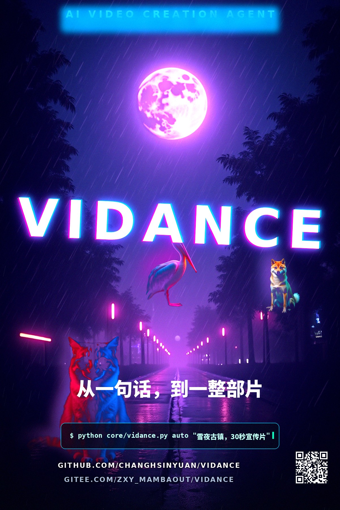

# ChangHsinYuan

正在做 **Vidance** —— 从一句话，到一整部片。

中文一句话概念，交给它：LLM 编剧 → 视频生成 → 双引擎配音 → 多模态审片 → 自动合成有声短片。

---

## Vidance · AI 有声短片生成

仓库与使用说明：[github.com/ChangHsinYuan/vidance](https://github.com/ChangHsinYuan/vidance)
